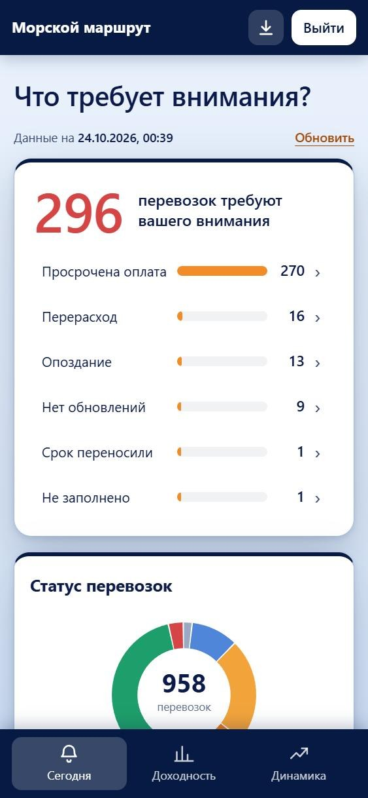
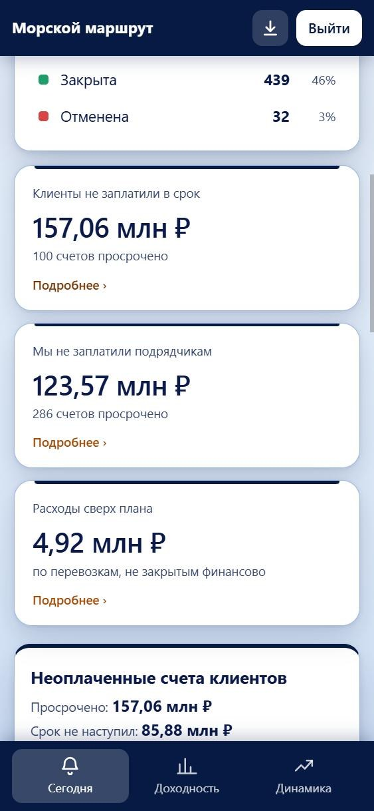
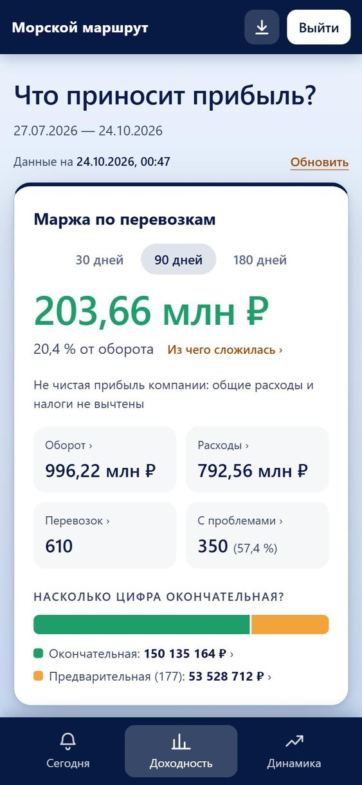
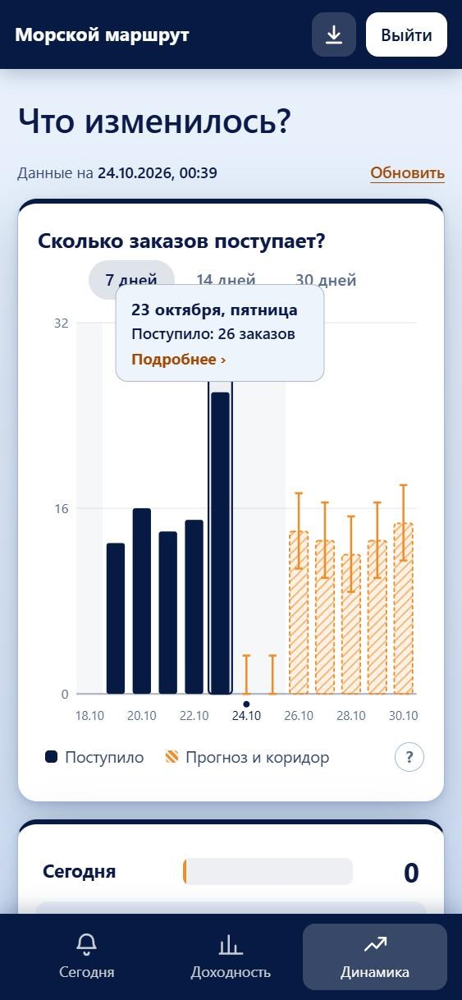
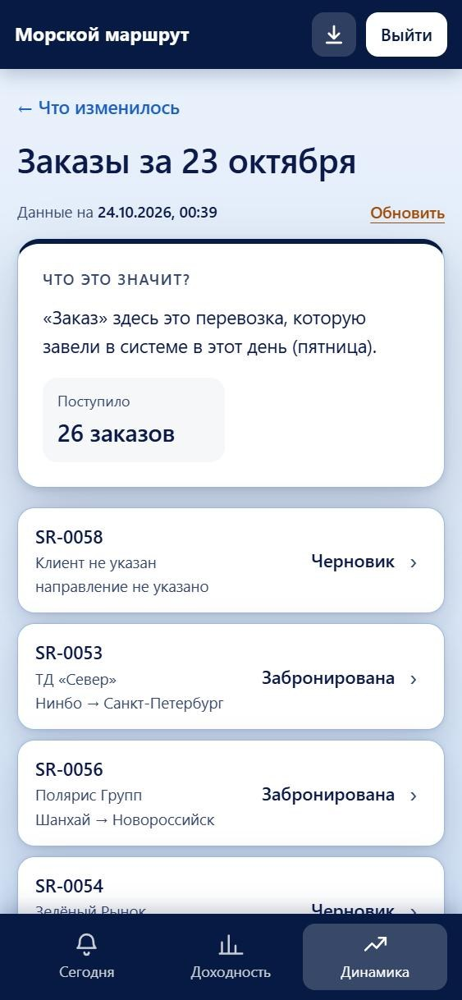
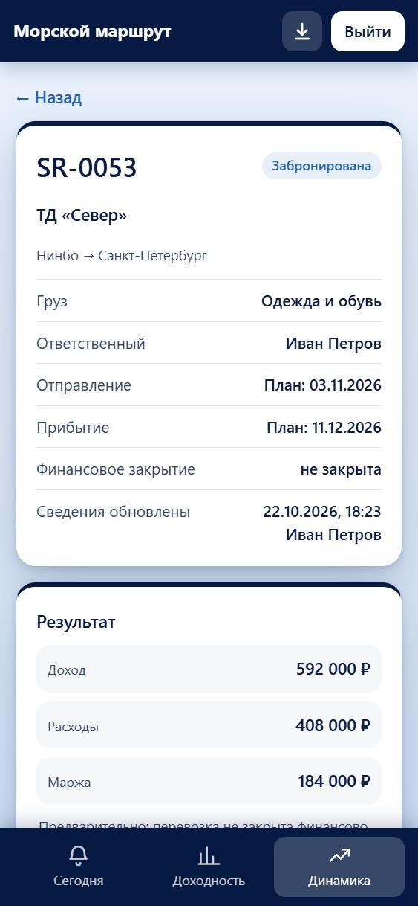
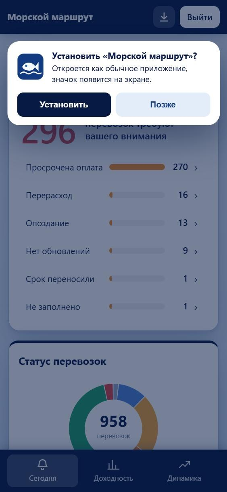
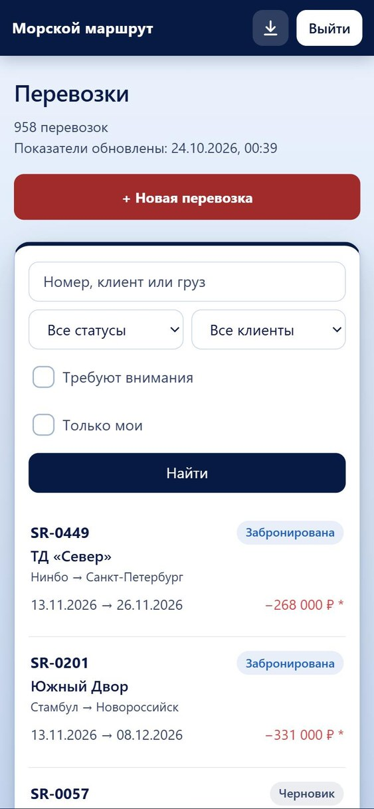
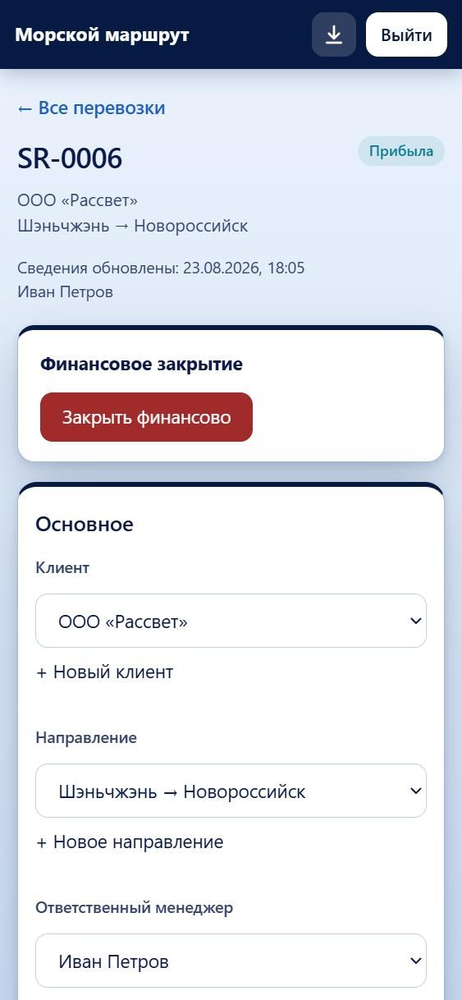

# Отчёт: проверка в условиях ежедневной работы и соответствие заданию

Дата последней проверки: 24.10.2026.

Задача: представить, что менеджеры ведут в приложении учёт каждый день, а руководитель по нему принимает решения, проверить приложение в этих условиях и ещё раз сверить его с заданием (ТЗ) по пунктам. Сценарии, проблемы и приоритеты определены самостоятельно. Решения и допущения занесены в [журнал решений](decision-log.md) (пункты 43–63).

## Что проверили

| Сценарий | Как |
|---|---|
| **Два года работы компании**: 3 000 перевозок, 13 600 строк | Генерация данных; сверка итогов руководителя (маржа перевозок, периоды, клиенты, направления, динамика) с независимым пересчётом по сырым строкам; замер скорости |
| **Месяц ежедневной работы**: 5 000 случайных операций менеджеров (создать, править, внести счёт, оплатить, закрыть, открыть, отменить, удалить), около половины с заведомо плохими данными | Тест `src/lib/fuzz.test.ts`; регулярная сверка цифр и правил целостности; прогон на 6 разных случайных последовательностей (30 000 операций). Чувствительность проверена: намеренная ошибка в 1 ₽ в расчёте маржи находится на первой же серии |
| **Два менеджера правят одну перевозку** | Тесты и проверка на живом приложении |
| **Эксплуатация и безопасность**: вход, блокировки, секрет сессий, пользователи, резервные копии, часовой пояс | Тесты и запуск «с нуля» на чистой копии репозитория: пустая база, настоящие пользователи, рабочая версия, вход по http, работа обеих ролей |
| **Прохождение по интерфейсу** обеих ролей на телефоне (375 px) и компьютере, каждая кнопка и форма | Руками в браузере и автоматически: обход всех ссылок (около 220 страниц: примерно 157 у руководителя и 63 у менеджера, плюс вход, «Нет связи» и страницы «не найдено»), на каждом экране проверка переполнения по ширине, ошибок в тексте, контраста, мелкого шрифта и кнопок без подписи |
| **Сквозной сценарий из ТЗ** на свежих демонстрационных данных | Вживую: менеджер вносит счёт больше сметы → через «Обновить» число на «Сегодня» вырастает с 19 до 20, «Перерасход» с 5 до 6, расходы сверх плана с 989 тыс. до 1,11 млн ₽ → руководитель открывает перевозку SR-0036 и видит причину и историю. Закрытие финансово, повторное открытие и «пересчитано задним числом» прошли теми же запросами, что вызывают кнопки |

## Что обнаружили и что сделали

Порядок по важности для ежедневной работы.

| № | Проблема | Решение | Как убедились |
|---|---|---|---|
| 1 | **Затирание чужих правок.** Два менеджера, открывшие одну перевозку, при сохранении молча перезаписывали изменения друг друга (форма строки отправляла все поля, даже если отметили оплату уже другой) | Формы отправляют только изменённые поля и то, какими они были; сервер отклоняет правку, если поле уже изменили, и называет кто и когда | Тесты; живая проверка: «Анна» с устаревшей карточкой получила отказ с именем и временем «Иван Петров, 15:08», значение Ивана осталось |
| 2 | **Задержка «прячется» переносом срока.** Опоздание считалось от текущей плановой даты: передвинул срок, и задержки как будто нет. Это ровно исходная боль руководителя | Причина «Срок переносили»; опоздание считается и к первоначальной дате (из истории); если опоздание уже видно, оно называет перенос | Тесты на 5 случаев; сквозной тест; демо-данные |
| 3 | **«1 847 перевозок требуют внимания из 881 в работе».** В числе были закрытые перевозки с неоплаченными счетами, а знаменатель их не включал; «Показать все» выводило бы тысячи карточек | Число включает закрытые с долгами и объяснено в расчётах; список растёт по 20; страницы подробностей показывают первые 100 строк | Тест нагрузки |
| 4 | **День считался по UTC.** Для Москвы с 00:00 до 03:00 «сегодня» было вчерашним днём: сроки, просрочки, «не обновлялась N дн.» сдвигались | «Сегодня» в часовом поясе компании (`APP_TIMEZONE`, по умолчанию Москва) | Тест на ночные границы |
| 5 | **Любой мог закрыть вход руководителю.** Пять неверных паролей на любой адрес блокировали вход всем на 15 минут | Блокировка по паре «адрес + e-mail» и общий потолок на адрес | Тесты: посторонний блокирует только свой адрес, руководитель входит с другого |
| 6 | **Нельзя завести менеджера или сменить пароль**, хотя на экране входа «обратитесь к администратору». Ушедший сотрудник сохранял бы доступ | Команда `npm run users` (добавить, сменить пароль, отключить, включить, список); отключённый теряет доступ сразу, в том числе в открытой сессии; единственного руководителя отключить нельзя | Тесты; запуск с нуля |
| 7 | **Секрет подписи сессий из образца** (`change-me…`) в рабочей среде позволял подделать вход | Образец и секрет короче 32 символов не используются: временный случайный секрет и предупреждение | Тесты, в том числе попытка подделки |
| 8 | **Резервных копий нет**, вся работа в одном файле | `npm run db:backup` (согласованная копия при работающем приложении, ротация), описание восстановления | Тест на живой базе с продолжающейся записью |
| 9 | **Закрыли перевозку, забыв внести доход:** маржа получается убытком | Предупреждение «В перевозке нет дохода» и подтверждение | Тесты |
| 10 | Мелочи: фильтр «Только мои» у менеджера; `/api/health` для мониторинга; защитные заголовки; даты в истории; Enter в полях «новый клиент»/«направление» не создаёт перевозку без них | Исправлено | Проверено в браузере |
| 11 | **На экране входа не были видны подписи «E-mail» и «Пароль»**: стиль подписей из экранов менеджера подмешивался на страницу входа (светлый текст на белом). Заметно после выхода из приложения | Стили входа закреплены за страницей | Проверено в браузере: подписи читаются при переходе с любого экрана |
| 12 | **«Сегодня» в обычных демо-данных считалось по UTC**, а приложение считает по Москве; дата обновления в карточке на «Сегодня» показывалась вчерашней, если правка сделана после полуночи | Демо-данные и дата на экране считаются по часовому поясу компании | Новый тест на дату; сценарий показа сверен с пересозданными данными |
| 13 | **Цвета при установке и на странице «Нет связи» остались от прежней тёмной схемы** (заставка, строка состояния) | Заставка светлая, панель #061A44; страница «Нет связи» светлая | Проверено в браузере |
| 14 | **Единообразие текста:** местами десятичная точка («19.1 %», «±0.5»), минус дефисом, неверное склонение («4 перевозок», «2 счетов», «1 перевозка… пересчитано») | Десятичная запятая, минус «−», склонение по числу одной функцией; те же правила в подписях и на страницах подробностей | Обход всех экранов; тесты проходят |
| 15 | **Мелкий и лишний текст:** шрифты 10,5–11,5 px, пояснения и подсказки под полями, пустые сообщения в форме, длинные пояснения в финансовом закрытии | Шрифты не меньше 11–12 px; лишние пояснения убраны, оставлено нужное | Автоматическая проверка размера шрифта на каждом экране |
| 16 | **Лишний код прежних версий экранов:** четыре неиспользуемых графика, шесть копий функции склонения, файлы расчётов вперемешку с остальными | Лишнее удалено; расчёты разложены по папкам `src/lib/calc` и `src/lib/analytics`; ссылки в документах обновлены | `npm run typecheck`, 188 тестов, обход всех страниц |

## Какие решения приняли и почему

- **Защита от затирания: сверка изменённых полей, а не версия всей записи.** Версия всей перевозки отклоняла бы правку, даже когда другой менеджер поменял несвязанное поле. Сверка по полям отказывает только при настоящем конфликте (и не отказывает, если чужое значение совпало с вводимым).
- **Опоздание от первоначальной даты, а не запрет переносов.** Переносы бывают законными (перевозчик сдвинул рейс), поэтому они не запрещены, а видны руководителю. Это рабочее допущение, оно описано в расчётах; пороги те же.
- **Пользователи через командную строку, а не экран администратора.** Для небольшой компании это проще и безопаснее (нет отдельной роли и экрана, которые нужно защищать); экран можно добавить позже.
- **Часовой пояс по умолчанию Москва**, меняется переменной.
- **Прогноз заказов простой и объяснимый**, а не машинное обучение: данных мало, руководителю нужно понимать, откуда число, а точность показана на экране.

## Соответствие заданию (ТЗ) по пунктам

| Требование ТЗ | Как выполнено | Результат проверки 24.10.2026 |
|---|---|---|
| **Веб-приложение менеджера**: клиент, груз и контейнеры, маршрут, ответственный менеджер, ход перевозки, сроки, доходы, расходы, оплаты | Список перевозок с поиском и фильтрами, форма новой перевозки, карточка с блоками «Основное», «Контейнеры», «Доходы и расходы», «Что и кто менял», финансовое закрытие | Выполнено. Пройдены список, форма, карточка, фильтры, закрытие и повторное открытие |
| **Неполные сведения** можно сохранить и дополнить позже | Обязательных полей нет: перевозка сохраняется черновиком, в списке видна пометка, недостающее перечислено, в маржу черновик не попадает | Выполнено |
| **Все изменения сохраняются в базе** | SQLite, история «кто, когда, что было → стало» по датам, статусам, суммам, оплатам, закрытию | Выполнено. Правка счёта сразу в базе и в истории |
| **Что требует внимания?** | Экран «Сегодня»: число перевозок, шесть причин, статусы, неоплаченные счета, деньги под риском, карточки с советом «Что сделать» | Выполнено. 19 перевозок на свежих данных, после правки менеджера 20 |
| **Что даёт хороший результат?** | Экран «Доходность»: маржа по перевозкам, окончательная и предварительная, оплаты клиентов, клиенты и направления с оборотом, маржей и долей проблемных; пометки «Выглядит лучше, чем работает» и «Работает хорошо» | Выполнено. «Рассвет»: оборот 35,9 %, маржа 3,5 % против 17 % по компании |
| **Что изменилось?** | Экран «Динамика»: заказы по дням с прогнозом, маржа к прошлому периоду, «Почему так вышло?», перевозки, которые повлияли, изменение по клиентам | Выполнено. Две причины дают полное изменение (−1 192 000 ₽), перевозки названы |
| **Подтверждающие данные** для каждого ответа | Каждая цифра и график ведут на страницу подробностей или список перевозок и дальше в карточку; суммы совпадают с цифрой, на которую нажали | Выполнено. Обход 157 страниц руководителя без ошибок |
| **Смысл показателя, период и ограничения расчёта** | «Что это значит?» на страницах подробностей, период в переключателях и датах, «Данные на …», предупреждения (устаревшие данные, «предварительно», «пересчитано задним числом», мало перевозок в прошлом периоде) | Выполнено. Под цифрой маржи постоянная подпись «Не чистая прибыль компании: общие расходы и налоги не вычтены» (журнал решений, п. 58) |
| **Доступ**: вход и разграничение ролей с проверками на сервере | Подписанная сессия, роль из базы на каждом запросе; менеджер не видит аналитику, руководитель ничего не меняет | Выполнено. Без входа 401, менеджер на аналитику 403 и возврат со страниц руководителя, руководитель на запись 403; тесты доступа |
| **Работающий PWA**, установка хотя бы в одном браузере | Манифест, значки, service worker, окно и кнопка «Установить» | Выполнено. Установка проверена на компьютере (`localhost`, Chrome и Edge). На телефоне нужен https: ограничение описано в README |
| **Разные представления данных**: от общего к клиенту, направлению, перевозке | «Доходность» → клиент или направление → перевозка; «Сегодня» → причина, статус, счета → перевозка; «Динамика» → день, клиент → перевозка | Выполнено |
| **Понятное состояние данных**: неполные сведения, ошибки загрузки, потеря связи | Пометки «предварительно» и «не заполнено», страницы ошибок и «не найдено», плашка «Нет связи с сервером…», страница «Нет связи» | Выполнено. Логика плашки и сохранённых страниц проверена тестами service worker |
| **Изменения учёта появляются в аналитике с понятной задержкой** | Пересчёт при чтении не реже чем раз в 5 минут и по кнопке «Обновить», время «Данные на …», на карточке перевозки сообщение «Есть изменения, которые ещё не попали в аналитику» | Выполнено. Вживую: до «Обновить» маржа SR-0036 193 000 ₽, после 71 000 ₽ |
| **Краткое понимание задачи, открытые вопросы, объём первой версии** | [docs/customer](customer/): понимание задачи с вопросами и варианты, ответы заказчика | Выполнено |
| **Короткий журнал решений** (вопрос → варианты → предложение → ответ или допущение → реализовано) | [decision-log.md](decision-log.md), 63 пункта; допущения без ответа названы | Выполнено. Открытых вопросов к заказчику нет |
| **Исходный код и инструкция для воспроизводимого запуска** | [README](../README.md): пять команд, `.npmrc` для установки без компилятора, рабочая версия, эксплуатация | Выполнено. Запуск «с нуля» проверен на чистой копии репозитория |
| **Тестовые пользователи и демонстрационные данные** с разными состояниями | Три пользователя, 58 перевозок (опоздания, просрочки, перерасход, неполные, отменённая, закрытые), крупный набор для графиков | Выполнено. Данные пересоздаются от сегодняшнего дня |
| **Описание расчётов и известных ограничений** | [calculations.md](calculations.md), [edge-cases.md](edge-cases.md) | Выполнено, обновлено под текущие экраны |
| **Несколько содержательных автоматических проверок** расчётов и доступа | 188 тестов: расчёты, аналитика на числах, проверяемых вручную, права и безопасность, нагрузка, случайные операции, одновременная правка, service worker | Выполнено. Все 188 проходят |
| **Что показать на сдаче**: правка менеджера → аналитика → руководитель → причина и действие | [demo-scenario.md](demo-scenario.md), сценарии 1–4 | Выполнено. Цепочка пройдена вживую |
| **Два-три примера использования ИИ** | [ai-usage.md](ai-usage.md): четыре примера и ещё случаи, где проверка поймала ошибку ИИ | Выполнено |
| Не требуется: интеграции с перевозчиками, реальные платежи, магазины приложений, офлайн-редактирование | Не делались | Соответствует ТЗ |

**Итог:** все пункты ТЗ выполнены. Одно ограничение описано: установка на телефон возможна только по https.

## Что оставили нерешённым

1. **Пользователь сам не может сменить пароль** (только администратор командой), нет восстановления пароля по почте.
2. **У руководителя нет «отметки о принятых мерах»**: список «Сегодня» на следующий день покажет те же перевозки, пока причина не устранена. Комментарии и «взято в работу» не сделаны (новый функционал).
3. **Нет уведомлений** (письма, push), руководитель сам открывает приложение.
4. **Деньги в целых рублях**, без копеек и НДС; **у строки одна дата оплаты** (при оплате частями вся сумма на дату последней).
5. **Одна база SQLite на одном сервере.** Подходит для десятков пользователей; для нескольких серверов нужна другая база. Резервные копии нужно настроить по расписанию самостоятельно.
6. **Без прокси адрес клиента неизвестен**, и защита входа считается только по e-mail (до 10 попыток); за прокси или туннелем она точнее.
7. **Установка на телефон только по https** (нужен сервер); размещение не входило в задачу.
8. **Контейнеры при одновременной правке** защищены слабее (сверка только у перевозок и строк денег).
9. **Правило «не обновлялась больше 5 дней»** шумит на перевозках, которые законно идут морем без новостей; порог настраивается, но это согласованное значение.
10. **Прогноз заказов грубый при малом потоке** и не знает о праздниках и акциях; на выходных заказов почти нет, и прогноз на них близок к нулю.

## Готово ли приложение к использованию

**Да, к пилотному использованию небольшой командой** (несколько менеджеров и руководитель, один сервер): цифры сходятся с пересчётом по сырым данным на тысячах перевозок и на тысячах случайных операций, одновременная работа не ломает данные, вход защищён, есть пользователи, копии и запуск с нуля, а каждый экран и каждая кнопка пройдены.

**Условия:** настроить `SESSION_SECRET`, поставить приложение за https (для установки на телефон), включить резервные копии по расписанию, завести реальных пользователей и отключить демо-записи. Пункты 1–3 из нерешённого стоит планировать следующими: без них ежедневная работа возможна, но менее удобна.

## Основные экраны на телефоне

Снимки сняты в рабочей версии на ширине телефона (375 px) на крупном демонстрационном наборе от 24.10.2026 (958 перевозок): на нём видны графики заказов. В обычном наборе (58 перевозок) цифры другие.

|  |  |  |  |
|---|---|---|---|
| Вход | Сегодня: что требует внимания | Сегодня: деньги под риском | Доходность |

|  |  |  |  |
|---|---|---|---|
| Динамика: заказы по дням и прогноз | Экран дня (после нажатия на подсказку) | Карточка перевозки у руководителя | Окно установки приложения |

|  |  |  |
|---|---|---|
| Менеджер: список перевозок | Менеджер: карточка перевозки | Нет связи с интернетом |
